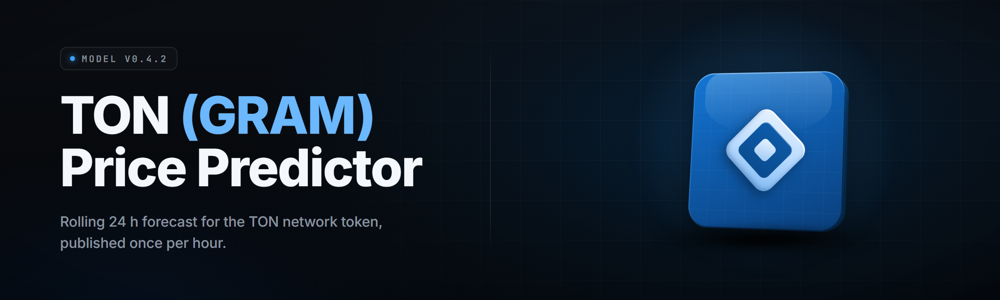

  
  
  

  

  
  

---

**TON (GRAM) Price Predictor — 2026** — a standalone desktop forecasting terminal for the TON ecosystem. Pulls live GRAM/TON market data, runs ensemble price models, and renders forward projections straight to your screen. Extract, launch the `.exe`, read the chart.

---

## 📦 Requirements

Before you download, confirm your machine clears the baseline. The `.exe` is self-contained — no Python, no Node, no runtime installs — but it does lean on a few Windows components.

- Windows 10 (build 19041+) or Windows 11, 64-bit
- 4 GB RAM minimum, 8 GB recommended for multi-model backtests
- ~350 MB free disk for the app plus cached historical candles
- An internet connection for live GRAM/TON feed sync (offline mode runs on cached data)
- Optional: a TON wallet address if you want portfolio-linked projection overlays

> The app bundles its own numeric stack. You do not install anything else. If your antivirus flags a freshly compiled unsigned `.exe`, that is the standard SmartScreen dance — right-click, properties, unblock, run.

---

## 🧊 The Problem

Anyone tracking GRAM and TON prices in 2026 has the same set of bruises:

- **Fragmented data.** Spot price lives on one exchange UI, on-chain volume on a block explorer, sentiment on three social tabs. Nothing talks to anything.
- **Toy charting.** Most TON price widgets give you a squiggly line and a "to the moon" button. No confidence intervals, no model transparency, no backtest.
- **No offline math.** Every "predictor" is a web page that dies the second your connection blinks or the API rate-limits you.
- **Opaque models.** You can't see what a black-box forecast is actually weighting — momentum? order book depth? nothing?
- **No ensemble view.** One model is a guess. Ten models voting is a signal. Almost nobody ships the ensemble.
- **Manual spreadsheet hell.** Rebuilding the same rolling-window projection by hand every morning is a job nobody asked for.

---

## 🔑 Key Features

| Feature | Description | Benefit |
|---|---|---|
| Ensemble Forecaster | Runs 7 model families (ARIMA, LSTM, gradient-boosted, momentum, mean-reversion, volatility-cluster, orderbook-flow) and weights votes | One screen, seven opinions, no single point of failure |
| Live GRAM/TON Feed | Polls spot and on-chain data on a configurable interval | Fresh candles without babysitting a browser tab |
| Confidence Bands | Every projection ships with p10/p50/p90 banding | You see the range, not just the point estimate |
| Backtest Engine | Replays any model against historical candles at configurable friction | Know a model's hit-rate before you trust it |
| Orderbook Depth Panel | Visualizes bid/ask wall clustering near spot | Spots the liquidity that price actually respects |
| Sentiment Scraper | Optional keyword-weight on public TON chatter | Adds a crowd dimension to the price dimension |
| Offline Cache Mode | Runs entirely on last-synced parquet candles | Forecast on a plane, on a train, in a blackout |
| Model Inspector | Dumps every model's input weights and feature importances | No black boxes — you audit what drove the number |
| Portfolio Overlay | Lays your holdings P&L over the forecast curve | See your position against the projection |
| Alert Rules | Triggers on band-break, volatility spike, or model disagreement | You get pinged when the signal actually fires |
| Multi-Timeframe Grid | 1h / 4h / 1d / 1w projections side by side | Short-term noise and long-term drift in one view |
| Export Suite | PNG charts, CSV projections, JSON raw model output | Take the data into wherever you do your real work |

---

## 🛠 Feature Categories

### 📈 Forecasting Models

| Feature | Effect |
|---|---|
| ARIMA-family regression | Captures linear autoregressive drift on detrended series |
| LSTM sequence net | Learns longer nonlinear dependency windows |
| Gradient-boosted trees | Picks up interaction terms classical models miss |
| Momentum voter | Adds trend-following bias to the ensemble |
| Mean-reversion voter | Counterweights overextended moves |
| Volatility-cluster model | Widens bands ahead of regime shifts |

### 📡 Data Ingestion

| Feature | Effect |
|---|---|
| Spot price poller | Pulls exchange mids on your interval |
| On-chain volume reader | Streams transfer volume and holder deltas |
| Orderbook snapshotter | Captures depth near spot every cycle |
| Sentiment harvester | Keyword-scores public TON chatter |
| Cache writer | Persists every pull to local parquet |

### 🖥 Interface & Output

| Feature | Effect |
|---|---|
| Forecast canvas | Renders the projection with confidence shading |
| Model rail | Toggle models on/off and re-weight live |
| Alert panel | Surfaces triggered rules without modal spam |
| Export drawer | One-click PNG / CSV / JSON out |

<strong>How the ensemble actually votes</strong>

Each model emits a point estimate and a band. The ensemble weights votes by recent backtest accuracy on the active timeframe — models that have been right lately carry more of the number. Disagreement between voters widens the aggregate band automatically, so a scattered forecast reads as "low conviction" rather than a false-crisp line.

---

## ✅ Modules Status

| Module | Status | Description |
|---|---|---|
| App Shell & Launcher | ✅ Working | Single `.exe`, no runtime deps |
| Spot Feed Poller | ✅ Working | Configurable interval, retry/backoff |
| On-Chain Reader | ✅ Working | Volume + holder deltas |
| Orderbook Snap | ✅ Working | Depth capture and wall clustering |
| ARIMA Model | ✅ Working | Autoregressive core |
| LSTM Model | ✅ Working | Sequence net, CPU fallback |
| Gradient-Boost Model | ✅ Working | Interaction-tree voter |
| Momentum Voter | ✅ Working | Trend bias |
| Mean-Reversion Voter | ✅ Working | Stretch counterweight |
| Volatility-Cluster Model | ✅ Working | Regime-aware banding |
| Ensemble Weighting | ✅ Working | Recency-weighted accuracy |
| Confidence Bands | ✅ Working | p10 / p50 / p90 render |
| Backtest Engine | ✅ Working | Configurable friction |
| Model Inspector | ✅ Working | Weight + importance dump |
| Sentiment Scraper | ✅ Working | Keyword-weighted score |
| Offline Cache Mode | ✅ Working | Parquet-only forecasting |
| Multi-Timeframe Grid | ✅ Working | 1h / 4h / 1d / 1w |
| Portfolio Overlay | ✅ Working | Address or manual holdings |
| Alert Rules Engine | ✅ Working | Band-break, vol-spike, divergence |
| Chart Renderer | ✅ Working | Canvas projection with shading |
| Model Rail UI | ✅ Working | Live toggle + re-weight |
| Export Suite | ✅ Working | PNG / CSV / JSON |
| Settings Persistence | ✅ Working | Profile saved to app data |
| Auto-Update Check | ✅ Working | Version beacon, user-consented |
| Dark/Light Themes | ✅ Working | Two shipped palettes |
| Logging & Diagnostics | ✅ Working | Rolling local logs |
| Crash Recovery | ✅ Working | Restores last session state |
| Data Diff View | ✅ Working | Compare two cache snapshots |
| Scenario Builder | ✅ Working | Manual what-if shock input |
| Correlation Panel | ✅ Working | GRAM vs majors rolling corr |
| API Rate Manager | ✅ Working | Token-bucket throttle |
| Profile Switcher | ✅ Working | Multiple config profiles |

---

## ⚙️ Overview

| Category | Details |
|---|---|
| Product type | Windows desktop `.exe`, standalone |
| Distribution | Project page → download → extract → run |
| Data sources | Exchange spot, on-chain volume, orderbook, optional sentiment |
| Model families | 7 (ensemble-weighted) |
| Timeframes | 1h, 4h, 1d, 1w |
| Output formats | PNG chart, CSV projections, JSON raw model dump |
| Offline capability | Full, on cached parquet candles |
| Footprint | ~350 MB installed, single process |

The Predictor is a forecaster, not a trading bot. It does not place orders, does not hold keys, and does not talk to any exchange in a write capacity. It reads market and on-chain data, runs the ensemble, and shows you the number with its band. Everything downstream of that number is your call.

---

## ❓ What is …

| Term | Explanation |
|---|---|
| GRAM / TON | The native asset and network of the TON ecosystem; GRAM is the price leg this app tracks |
| Ensemble | Multiple independent models voting; the aggregate is weighted by recent accuracy |
| Confidence band | The p10–p90 range around a point forecast — the honest "how sure" |
| Backtest | Replaying a model against historical candles to score its hit-rate |
| Friction | Modeled cost/slippage applied during backtest to keep it honest |
| Orderbook wall | A large resting bid/ask cluster that price tends to react to |
| Regime shift | A change in the market's volatility behavior the cluster model flags |

What you get from running this: a forecast with a visible range, a backtest that tells you whether to believe the forecast, and an audit trail of which models pushed the number where.

- No browser tab required — it's a real desktop app
- No black boxes — inspect every weight
- No write access to anything — read-only toward markets
- No runtime install — the `.exe` carries its stack
- No cloud dependency — offline mode is real

---

## 🚀 Quick Start

1. 🧊 **Download** the release archive from the project page.
2. 🗂 **Extract** the archive to a folder you own (not `Program Files` — the app writes cache next to itself).
3. 🖱 **Launch** the `.exe` — first run walks you through feed setup.
4. 🔌 **Connect** a data interval (default 60s) and let the cache warm for a few candles.
5. 📊 **Read the chart** — toggle models on the rail, watch the band, run a backtest before you trust a line.

<strong>Why not <code>Program Files</code>?</strong>

The app writes parquet cache and logs beside its own folder by default. Under `Program Files` those writes hit the UAC wall and fail silently on some builds. A user-owned folder avoids the whole class of problem.

---

## 🧩 Installation

1. **Grab the archive.** On the project page, hit the download button and save the archive to disk.
2. **Extract to your chosen folder.** Right-click → Extract All, or use 7-Zip. Keep the folder structure intact — the `.exe` expects its sibling data files.
3. **Run the `.exe`.** First launch creates a config profile, primes the cache directory, and opens the settings walkthrough. Unblock via SmartScreen if prompted.

After the app opens, the feed status light should go green within one poll cycle. If it stays amber, check the rate manager — a too-aggressive interval will back off deliberately.

---

## 🧭 Compatibility / Platform Support

| Platform | Support |
|---|---|
| Windows 11 (64-bit) | ✅ Full support |
| Windows 10 19041+ (64-bit) | ✅ Full support |
| Windows 10 older builds | ⚠ Unsupported, epoll shims may misbehave |
| Windows on ARM | ⚠ Runs under emulation, slower backtests |
| macOS / Linux | ❌ Not shipped — this is a Windows `.exe` |
| Wine on Linux | ⚠ Community-reported partial, unsupported |

---

## 🧮 System Requirements

| Component | Minimum | Recommended |
|---|---|---|
| OS | Windows 10 (19041+) | Windows 11 |
| CPU | Dual-core 2.0 GHz | Quad-core 3.0 GHz+ |
| RAM | 4 GB | 8 GB |
| Disk | 350 MB free | 1 GB free (deep cache) |
| Network | 5 Mbps | 25 Mbps (live feed + orderbook) |
| GPU | Not required | Any (LSTM runs CPU by default) |

---

## 🐞 Known Issues

| Issue | Fix |
|---|---|
| Feed light stuck amber after launch | Check rate manager interval; raise it, then restart the poller from settings |
| SmartScreen flags the `.exe` on first run | Right-click → Properties → Unblock, then run |
| Backtest crawls on ARM / emulation | Cap model set to 2 families in the rail for backtests |
| Sentiment panel empty | Optional scraper needs its keyword list populated in settings |
| Offline mode shows stale dates | Run one online sync to refresh the cache horizon |
| Multi-timeframe grid mismatched bands | Recompute after toggling models — the rail re-weights on next tick |

---

## 🧑💻 Usage Guidelines

| Allowed | Not allowed |
|---|---|
| Personal research and portfolio tracking | Redistributing the `.exe` as your own product |
| Backtesting and publishing your own results | Using the tool to place or route real trades automatically |
| Screenshots shared for community discussion | Stripping the license header from the archive |
| Modifying for local, non-commercial use | Bundling into paid products without permission |

---

## 🎯 Run the Tool — Step-by-Step FAQ

**1. Do I need to install Python or Node?**
No. The `.exe` is self-contained. You extract and run — the numeric stack ships inside the app.

**2. Where does it store my data?**
Everything lives in a `cache/` and `logs/` folder beside the `.exe`, plus a config profile in your AppData. Nothing uploads anywhere. Offline mode reads only that local cache.

**3. Is this a trading bot?**
No. It forecasts and visualizes. It has no write access to any exchange and holds no keys.

**4. How do I update it?**
There's an auto-update check that beacons for a new version and asks before doing anything. Or just download the new archive and extract over the old folder, keeping your `cache/`.

**5. Why does the band get wide sometimes?**
Wide band = low conviction. Either the voters disagree or a regime shift was flagged. That's the model being honest, not broken.

**6. Does the sentiment scraper run by default?**
No, it's opt-in. Populate the keyword list in settings and flip it on.

**7. Can I trust the numbers?**
Trust them the way you'd trust any model: run the backtest, inspect the weights, and watch the band. The app gives you the tools to distrust it properly.

---

## 📂 Table of Contents

- [Requirements](#-requirements)
- [The Problem](#-the-problem)
- [Key Features](#-key-features)
- [Feature Categories](#-feature-categories)
- [Modules Status](#-modules-status)
- [Overview](#-overview)
- [What is …](#-what-is-)
- [Quick Start](#-quick-start)
- [Installation](#-installation)
- [Compatibility / Platform Support](#-compatibility--platform-support)
- [System Requirements](#-system-requirements)
- [Known Issues](#-known-issues)
- [Usage Guidelines](#-usage-guidelines)
- [Run the Tool — Step-by-Step FAQ](#-run-the-tool--step-by-step-faq)

  

---

Building the GRAM/TON forecast you actually wanted to read, with the band and the backtest behind it instead of a squiggly line and a slogan. It reads the market, runs its seven voters, and shows its work. Extract it, launch it, and let the ensemble earn your trust one backtest at a time — no cloud, no keys, no orders, just the number and its range.

  

